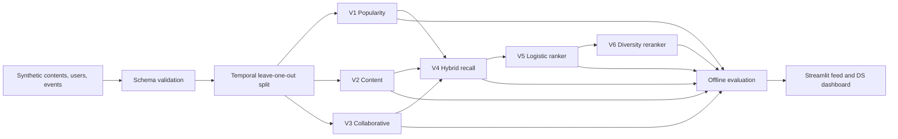

# Personalized & Diverse Crypto Content Recommender

An end-to-end recommendation and experimentation portfolio project for new retail crypto-content
users. It implements six recommendation strategies, temporal offline evaluation, product analytics,
an A/B test proposal, failure analysis, and an interactive Streamlit demo.

> **Responsible-use notice:** All users and interactions are synthetic. This project is not
> affiliated with Binance, does not reproduce private systems, and does not provide financial or
> investment advice.

## Problem

New crypto users face information overload, little behavioral history, uneven content quality,
and feeds dominated by a small number of popular topics or sources. The research question is:

> How can a recommendation system surface relevant, timely, and diverse crypto content when user
> interaction history is limited?

The product serves two audiences:

- **New retail users:** discover understandable, relevant, and varied educational or market content.
- **Product/data teams:** compare strategies, inspect cohort performance, analyze failures, and
  design a safe online experiment.

See [PROJECT_PROPOSAL.md](PROJECT_PROPOSAL.md) for the full problem definition.

## Six versions

| Version | Strategy | Purpose |
|---|---|---|
| V1 | Time-decayed popularity | Establish a strong non-personalized baseline |
| V2 | TF-IDF content-based | Model user interests and support new content/cold start |
| V3 | Item-item collaborative filtering | Learn co-interest patterns from behavior |
| V4 | Hybrid recall | Combine popularity, content, collaborative, and exploration signals |
| V5 | Logistic regression ranking | Learn a second-stage score from user/content/context features |
| V6 | Diversity reranking | Balance relevance with topic and source exposure constraints |

The ranking model uses content similarity, popularity, collaborative score, topic and coin overlap,
difficulty match, quality, freshness, and user activity. V6 constrains source/topic concentration
and uses novelty-aware greedy reranking.

## Architecture



## Offline evaluation

For each synthetic user, the latest positive user-content pair is held out and all events for that
pair are removed from training. Models rank unseen content using only the remaining history.

Current deterministic run (`seed=42`, `k=10`):

| Model | Hit/Recall@10 | NDCG@10 | Catalog coverage | Diversity |
|---|---:|---:|---:|---:|
| V1 Popularity | 0.1875 | 0.0921 | 0.1000 | 0.8580 |
| V2 Content-based | **0.2375** | **0.1037** | 0.8458 | 0.6743 |
| V3 Collaborative | 0.0625 | 0.0313 | 0.8667 | **0.8758** |
| V4 Hybrid | 0.2250 | 0.0934 | 0.7750 | 0.7216 |
| V5 Logistic ranker | 0.1000 | 0.0447 | 0.8375 | 0.7297 |
| V6 Diversity reranking | 0.1000 | 0.0435 | **0.8750** | 0.8559 |

The learned ranker underperforms the simpler content and hybrid models. This is intentionally
reported rather than hidden: a stronger production approach would improve exposure labels,
negative sampling, calibration, and candidate-level training. V6 materially raises diversity and
coverage relative to V5, demonstrating the relevance-diversity trade-off.

Full results: [reports/EXPERIMENT_RESULTS.md](reports/EXPERIMENT_RESULTS.md).

## Product analytics and experimentation

- DuckDB SQL analysis of the event funnel, persona cohorts, sources, and daily activity.
- Metrics: Hit Rate@10, Recall@10, NDCG@10, catalog coverage, topic/source coverage, diversity.
- Logged failure hypotheses for missed held-out items.
- A/B proposal with randomization, primary/secondary metrics, guardrails, instrumentation, and
  decision rules.

Reports:

- [Data schema](reports/DATA_SCHEMA.md)
- [EDA](reports/EDA_REPORT.md)
- [Experiment results](reports/EXPERIMENT_RESULTS.md)
- [A/B test proposal](reports/AB_TEST_PROPOSAL.md)
- [Failure analysis](reports/FAILURE_ANALYSIS.md)
- [Model card](reports/MODEL_CARD.md)

## Run locally

Requires Python 3.9+.

```bash
git clone https://github.com/chelsietao/crypto-content-recommender.git
cd crypto-content-recommender
python3 -m venv .venv
source .venv/bin/activate
python -m pip install -r requirements.txt
python -m pytest -q
python -m src.run_pipeline
streamlit run app.py
```

Or use:

```bash
make test
make pipeline
make app
```

The app contains:

- A persona-based feed with six selectable strategies and recommendation explanations.
- A data-science dashboard comparing relevance, coverage, diversity, persona cohorts, and ranking
  coefficients.
- Methodology, limitations, and production next steps.

## Repository structure

```text
.
├── app.py                       # Streamlit feed and dashboard
├── src/
│   ├── analytics.py             # DuckDB SQL and EDA charts
│   ├── config.py                # Shared configuration
│   ├── data_pipeline.py         # Deterministic synthetic data and validation
│   ├── evaluation.py            # Temporal split and recommender metrics
│   ├── recommenders.py          # Six recommendation strategies
│   └── run_pipeline.py          # End-to-end artifact/report generation
├── tests/                       # Data, split, model, and metric tests
├── reports/                     # Schema, EDA, experiments, A/B design
├── data/raw/                    # Small teaching samples only
├── data/processed/              # Generated locally; ignored by Git
└── artifacts/                   # Generated metrics/charts; ignored by Git
```

## Skills demonstrated

- Recommender systems: recall, ranking, cold start, and diversity
- Machine learning and feature engineering
- Python, pandas, scikit-learn, DuckDB SQL
- Temporal offline evaluation and leakage prevention
- Product analytics, A/B testing, and guardrail metrics
- Data contracts, validation, testing, and reproducibility
- Streamlit product prototyping and technical communication

## Limitations and next steps

- Synthetic behavior validates implementation, not real user impact.
- TF-IDF is intentionally lightweight; multilingual embeddings could improve semantic retrieval.
- Collaborative filtering is sensitive to sparse interaction history.
- The ranker needs better negative sampling and impression-position features.
- A production system would require real-time feature pipelines, policy filters, bot detection,
  model monitoring, latency budgets, privacy review, and online A/B testing.
- Financial content needs stronger source quality, misinformation, suitability, and compliance
  controls than ordinary media recommendation.

## License and data

Code is provided as a portfolio research implementation. Generated URLs and behavioral records are
synthetic. The small CSV files in `data/raw/` are teaching fixtures, not scraped articles.
