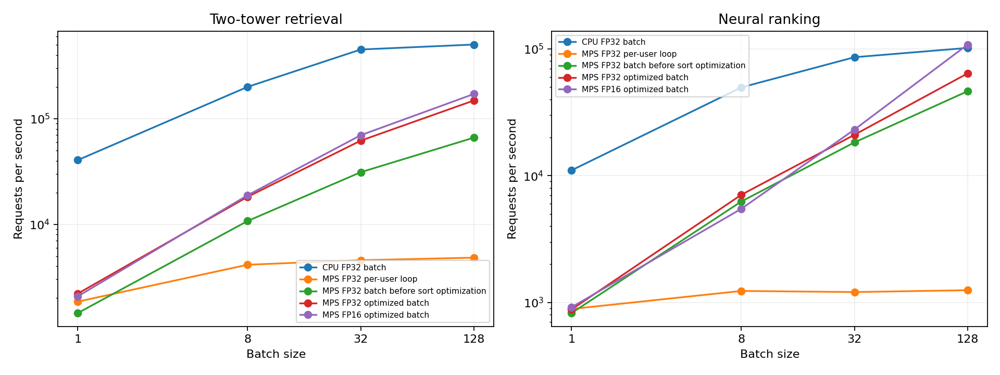

# GPU 效能量測：輪替順序、逐回合比較與產出驗證

本次檢查 profiling 的模式順序與產出使用流程，發現三種 MPS 模式固定依序量測，且繪圖入口會接受雜湊不符的摘要，因此改為六回合輪替，保存逐回合比較，並在量測完成及繪圖前核對檔案與統計內容。

## 1. 本次修正

| 項目 | 完成內容 |
|---|---|
| 模式順序 | 三種 MPS 模式按回合輪替，在六回合中各佔每個位置兩次 |
| 回合座標 | 每筆計時保存回合、批次索引與模式位置，避免不同回合的資料混用 |
| 效能比較 | 使用同回合、同精度、同模型及同批次大小的吞吐量計算倍率 |
| checkpoint | 載入前核對相鄰 manifest 的 SHA-256，拒絕檔案與聲明不一致的權重 |
| 產出驗證 | 核對必要檔案、雜湊、量測覆蓋、原始計時、使用者清單與推薦驗證 |
| 繪圖入口 | 驗證通過後才讀取摘要產圖，量測完成時移除該目錄前一輪的舊圖 |
| 重現檢查 | 新增 `--verify-only`，可在 CPU 環境驗證已匯出的結果 |

檢查時曾修改摘要的吞吐量並保留原 manifest，原繪圖入口仍產生圖表，本次以對應回歸測試確認雜湊不符會中止，圖檔不會被寫出。

## 2. 六回合輪替設計

每組 MPS 輸入先完成推薦結果核對，三種模式各暖機 2 批，再依下表完成六個回合，每個模式在每回合量測 10 批。

| 回合 | 第一個模式 | 第二個模式 | 第三個模式 |
|---|---|---|---|
| 1 | 逐筆迴圈 | 原批次路徑 | 優化批次路徑 |
| 2 | 原批次路徑 | 優化批次路徑 | 逐筆迴圈 |
| 3 | 優化批次路徑 | 逐筆迴圈 | 原批次路徑 |
| 4 | 逐筆迴圈 | 原批次路徑 | 優化批次路徑 |
| 5 | 原批次路徑 | 優化批次路徑 | 逐筆迴圈 |
| 6 | 優化批次路徑 | 逐筆迴圈 | 原批次路徑 |

各模式使用同一組輸入與模型權重，計時前後等待 GPU 完成，順序記錄於 `mode_schedule.csv`，回合在 CSV 中以 0 至 5 編號，每個位置的實際次數也由驗證流程核對。

本次計時範圍從已準備的裝置輸入開始，到裝置上的前十筆推薦輸出完成，輸入準備、推薦結果核對、階段探測與 trace 擷取各自執行。

## 3. 逐回合比較的計算

每個回合的每秒請求量，以該回合的批次大小乘以量測批數，再除以該回合的總量測秒數，同一回合的優化路徑吞吐量除以基準路徑吞吐量，得到一個配對倍率。

`paired_comparison.csv` 保存六回合的每個倍率，包含原批次路徑及逐筆迴圈兩種基準，摘要表保留六個比值的最小值、中位數與最大值。

批次大小 128、FP32、以原批次路徑為基準，本次結果如下。

| 模型          |   回合數 |   倍率最小值 |   倍率中位數 |   倍率最大值 |
|:--------------|---------:|-------------:|-------------:|-------------:|
| V7 雙塔召回   |        6 |        1.914 |        2.3   |        2.42  |
| V8 神經排序器 |        6 |        1.2   |        1.364 |        1.599 |

上表的中位數來自六個逐回合倍率，整體吞吐量則以六回合的總請求數除以總時間計算，兩種統計分別保存。

## 4. 產出驗證流程

`verify_report` 會先核對 manifest 列出的檔案與 SHA-256，再讀取原始計時與驗證表，依量測設定檢查以下內容。

| 驗證對象 | 驗證內容 |
|---|---|
| 檔案集合 | 必要檔案、格式版本及圖檔的 manifest 覆蓋 |
| 計時數值 | 延遲為正的有限值，樣本座標沒有重複或缺漏 |
| 計時範圍 | 每個裝置、精度、模型、模式與批次大小都包含指定回合及批次 |
| 統計摘要 | 從原始延遲重算 p50、p95 與每秒請求量，核對 CSV 與 JSON 摘要 |
| 固定使用者核對 | 每個精度與模型包含相同的已聲明使用者清單 |
| 逐組請求核對 | 請求索引連續，使用者順序符合該批輸入，FP32 順序及分數核對通過 |
| 量測順序 | 每回合的位置符合輪替規則，順序表與逐批紀錄相符 |
| 配對倍率 | 從同回合的原始計時重算，核對每筆比值 |

驗證支援原有 profiling 報告，本次格式版本為 2，增加模式順序、逐回合倍率與使用者清單，繪圖與 `--verify-only` 使用相同的驗證入口。

## 5. 本次實測結果

本次使用 Apple M5 Pro、24.0 GiB 統一記憶體、Python 3.9.6 與 PyTorch 2.6.0，執行裝置為 MPS，CPU 運算執行緒為 1，關閉 MPS CPU fallback，內容清單有 199 筆。

| 證據 | 本次數量 |
|---|---:|
| 裝置、精度、模式與批次組合 | 56 |
| 每組計時回合 | 6 |
| 每組逐批計時 | 60 |
| 全部逐批計時 | 3,360 |
| 模式順序紀錄，包含 CPU 參考 | 336 |
| 逐回合配對倍率 | 192 |
| 逐組推薦結果核對 | 2,366 |
| 固定 81 位使用者的精度核對 | 486 |

批次大小 128、FP32 的實測摘要如下。

| 裝置   | 模型          | 路徑             |   整批 p50 ms |   整體請求／秒 |
|:-------|:--------------|:-----------------|--------------:|---------------:|
| cpu    | V7 雙塔召回   | batched          |         0.226 |       505295   |
| cpu    | V8 神經排序器 | batched          |         1.222 |       101769   |
| mps    | V7 雙塔召回   | per_user_loop    |        26.416 |         4821.2 |
| mps    | V7 雙塔召回   | batched_baseline |         1.854 |        66235.4 |
| mps    | V7 雙塔召回   | batched          |         0.806 |       149018   |
| mps    | V8 神經排序器 | per_user_loop    |       102.172 |         1249.3 |
| mps    | V8 神經排序器 | batched_baseline |         2.737 |        46375   |
| mps    | V8 神經排序器 | batched          |         1.833 |        64077.5 |



CPU、MPS 逐筆及批次路徑的數值保留於同一份摘要，推薦結果延續前版的裝置、精度、內容 ID、數量與順序核對，記憶體取樣與同步階段計時也保存於本次目錄。

## 6. 回歸測試

本次新增 18 個測試案例，實體 MPS 環境的完整測試通過 144 項，測試包含輪替位置平衡、回合座標、已知數值的統計公式、產出修改、模式順序錯誤、驗證覆蓋缺漏、錯誤使用者及 checkpoint 雜湊。

產出修改測試會在變更摘要、倍率、順序或驗證資料後重算檔案雜湊，再確認內容一致性檢查會拒絕，另以保留原雜湊的修改確認繪圖會在寫檔前中止。

## 7. 執行方式

以下指令會完成六回合 MPS 量測，量測結束後驗證產出，再執行繪圖與獨立結果檢查。

```bash
python -m pip install -r requirements-gpu.txt
PYTORCH_ENABLE_MPS_FALLBACK=0 python -m pytest -q
python -m src.run_neural --verify-only
PYTORCH_ENABLE_MPS_FALLBACK=0 python -m src.profile_gpu \
  --batch-sizes 1 8 32 128 --iterations 10 --repetitions 6 \
  --output reports/gpu_profile_audit
python -m src.plot_gpu_profile --input reports/gpu_profile_audit
python -m src.profile_gpu --verify-only --output reports/gpu_profile_audit
```

GitHub Actions 執行本次回歸案例與已匯出報告的 `--verify-only`，MPS 裝置測試依硬體條件執行，本次實體 MPS 測試結果來自本機執行。

## 8. 程式與證據索引

| 檔案 | 內容 |
|---|---|
| [src/profile_gpu.py](src/profile_gpu.py) | 六回合輪替、checkpoint 核對與 profiling |
| [src/gpu_report.py](src/gpu_report.py) | 統計重算、逐回合倍率與產出驗證 |
| [src/plot_gpu_profile.py](src/plot_gpu_profile.py) | 驗證後產圖 |
| [tests/test_gpu_report.py](tests/test_gpu_report.py) | 本次量測方法與資料完整性案例 |
| [逐批計時](reports/gpu_profile_audit/timings.csv) | 3,360 筆延遲、回合與模式位置 |
| [模式順序](reports/gpu_profile_audit/mode_schedule.csv) | 336 筆實際執行順序 |
| [逐回合倍率](reports/gpu_profile_audit/paired_comparison.csv) | 192 筆配對比較 |
| [摘要](reports/gpu_profile_audit/summary.csv) | 各設定的 p50、p95 與吞吐量 |
| [執行設定](reports/gpu_profile_audit/results.json) | 硬體、來源雜湊、使用者及量測設定 |
| [逐組推薦核對](reports/gpu_profile_audit/variant_validation.csv) | 各量測路徑的輸出驗證 |
| [精度核對](reports/gpu_profile_audit/precision_validation.csv) | 固定使用者的精度結果 |
| [記憶體取樣](reports/gpu_profile_audit/memory_samples.csv) | MPS 張量與 Metal 驅動配置 |
| [階段計時](reports/gpu_profile_audit/stages.csv) | 原路徑與優化路徑的同步計時 |
| [CPU 派發 trace](reports/gpu_profile_audit/cpu_dispatch_trace.json) | 主機算子及 profiling 階段 |
| [檔案雜湊](reports/gpu_profile_audit/manifest.json) | 本次產出檔案的 SHA-256 |
| [前版修正說明](README_GPU_PROFILING_REVIEW.md) | 候選上限與逐組結果核對 |
