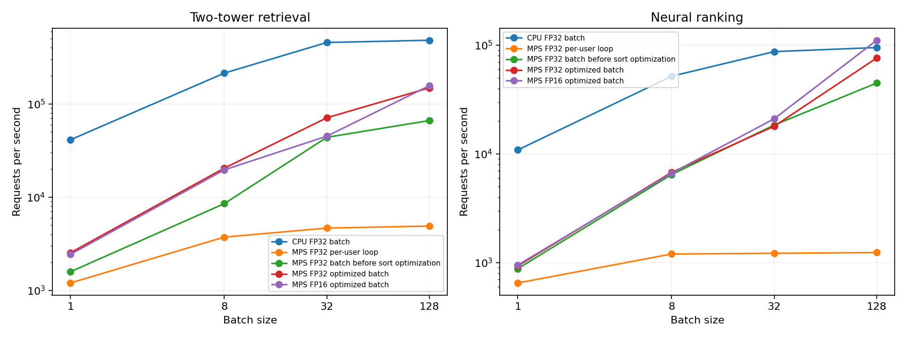

# Apple GPU 推薦推論：MPS Profiling 與批次排序優化

本版本沿用已訓練的雙塔召回與神經排序器，在 Apple GPU 的 MPS 後端完成批次推論、同步階段 profiling、排序優化，以及 FP32、FP16 的速度與推薦結果核對，並保存原始計時、記憶體取樣及派發 trace。

## 1. 檢查與完成範圍

服務 1.1 的 95 項既有測試與 checkpoint 驗證通過，本次新增裝置上的批次推論路徑，完成含實體 MPS 運算的 108 項測試，兩個模型的 FP32 輸出均與 80 位既有使用者及 1 位新使用者的 checkpoint 推薦核對。

| 元件 | 本次完成內容 |
|---|---|
| 批次推論 | 使用者特徵與已讀遮罩依批次準備，內容向量與內容特徵常駐選定裝置 |
| 雙塔召回 | 以矩陣乘法處理一批使用者，接著排除已讀內容並選取候選 |
| 神經排序器 | 將整批候選的使用者向量、內容向量與交互特徵送入同一個排序網路 |
| 排序優化 | V7 沿用召回順序，V8 將候選分數放入內容 ID 順序的矩陣，再執行一次穩定排序 |
| profiling | 分別保存同步階段計時、CPU 派發 trace、排序算子次數與 MPS 記憶體取樣 |
| 精度實驗 | 核對 FP32 與 FP16 的推薦順序、前十筆集合及共同內容分數 |

## 2. GPU 批次推論流程

`BatchedNeuralInference` 從 checkpoint 複製權重，將模型與固定內容特徵移至選定裝置，預算並保留內容向量，再依使用者清單建立輸入與已讀遮罩。

整批使用者向量與內容向量相乘後得到使用者對內容的分數矩陣，已讀內容的分數設為負無限值，再保留每位使用者的前 50 筆候選，V7 取候選的前 10 筆，V8 對候選執行神經排序後取前 10 筆。

內容軸按照內容 ID 排列，穩定排序在同分情況下保留 ID 次序，完全看過的內容清單會產生空推薦，裝置上的結果可透過 `decode` 轉回內容 ID 與分數。

```python
from pathlib import Path
import torch
from src.neural import NeuralSystem
from src.gpu_inference import BatchedNeuralInference

system = NeuralSystem.load(Path("artifacts/neural/neural_recommender.pt"))
engine = BatchedNeuralInference(system, device="mps", dtype=torch.float32)
batch = engine.prepare(["U0001", "U0042", "new-user"])
indices, scores = engine.forward(batch, "v7_pytorch_two_tower")
print(engine.decode(indices, scores))
```

## 3. Profiling 發現與排序優化

批次推論的原始路徑會先將候選按 ID 排列，再按推薦分數排序，階段計時顯示這段最後排序具有可量測的成本，因此本次針對兩個模型各自處理結果選取。

V7 的候選已依召回分數與 ID 排好，輸出階段直接切出前 10 筆，V8 將候選分數 scatter 到按 ID 排列的完整內容軸，透過一次穩定排序完成分數與 ID 的排序規則。

CPU 派發 trace 中的 `aten::sort` 呼叫次數，核對結果如下。

| 模型 | 原批次路徑的排序呼叫 | 優化路徑的排序呼叫 |
|---|---:|---:|
| V7 雙塔召回 | 3 | 1 |
| V8 神經排序器 | 3 | 2 |

批次大小 128、FP32 的最後選取與排序階段，中位數計時如下。

| 模型          | 路徑      |   最後選取／排序 p50 ms |
|:--------------|:----------|------------------------:|
| V7 雙塔召回   | baseline  |                  0.8812 |
| V7 雙塔召回   | optimized |                  0.0095 |
| V8 神經排序器 | baseline  |                  0.7541 |
| V8 神經排序器 | optimized |                  0.3951 |

階段探測在每一階段結束後等待 GPU 完成，記錄主機派發與 GPU 完成的合計時間，CPU trace 另以獨立回合擷取算子與呼叫階層，MPS profiler 的 interval signpost 在擷取回合啟用。

CPU trace 描述主機派發，GPU 階段耗時來自同步計時，整批效能在另一輪量測，使用每批末端的一次完成同步，分段中位數與整批中位數各自計算。

## 4. 批次大小 128 的排序優化結果

以下兩條路徑使用相同 MPS 裝置、FP32 權重、輸入與批次大小，原批次路徑與優化路徑都保存於程式，可用同一個指令重現量測。

| 模型          |   原批次 p50 ms |   優化批次 p50 ms |   原批次請求／秒 |   優化批次請求／秒 |   吞吐量倍數 |
|:--------------|----------------:|------------------:|-----------------:|-------------------:|-------------:|
| V7 雙塔召回   |           1.876 |             0.845 |          66331.1 |           148795   |         2.24 |
| V8 神經排序器 |           2.577 |             1.643 |          44927.5 |            76299.6 |         1.7  |

本次排序優化使 V7 與 V8 的 MPS 批次吞吐量分別成為原批次路徑的 2.24 倍與 1.70 倍，效能數值對應本次 199 筆內容、批次大小 128 與裝置常駐輸入的量測。

## 5. 批次與精度實驗

每個組合暖機 2 批，量測 3 回合，每回合 10 批，共 30 筆整批延遲，另測量 CPU FP32 批次路徑作為同一台機器的參考，完整資料包含逐筆 GPU 迴圈、原批次及優化批次路徑。

| 模型          |   批次大小 |   CPU FP32 請求／秒 |   MPS FP32 請求／秒 |   MPS FP16 請求／秒 |
|:--------------|-----------:|--------------------:|--------------------:|--------------------:|
| V7 雙塔召回   |          1 |             41272.5 |              2538.6 |              2437.3 |
| V7 雙塔召回   |          8 |            213991   |             20475.8 |             19638.5 |
| V7 雙塔召回   |         32 |            455796   |             71010.9 |             45120.6 |
| V7 雙塔召回   |        128 |            481550   |            148795   |            156937   |
| V8 神經排序器 |          1 |             10889   |               932.5 |               949.9 |
| V8 神經排序器 |          8 |             51865.3 |              6773.3 |              6655.5 |
| V8 神經排序器 |         32 |             87373.4 |             17969.2 |             21063.9 |
| V8 神經排序器 |        128 |             95276.3 |             76299.6 |            111142   |



本次 CPU FP32 批次路徑在兩個模型的批次大小 128 上，吞吐量分別為 481,549.9 與 95,276.3 筆／秒，圖表保留 CPU 與 MPS 各路徑的實測值，這些數值的範圍為已準備輸入至裝置上的推薦輸出。

輸入準備與裝置傳輸另存於 `input_preparation.csv`，HTTP 服務的量測資料保留於服務版本的報告目錄。

## 6. 推薦結果與精度核對

每個精度均使用 81 位使用者核對，資料包含原有 80 位合成使用者與 1 位新使用者，前十筆內容集合與分數使用 CPU checkpoint 的推薦結果作為參考。

| 精度    | 模型          | 順序完全一致   | 前十筆集合重合率   |   共同內容最大分數誤差 |
|:--------|:--------------|:---------------|:-------------------|-----------------------:|
| float16 | V7 雙塔召回   | 76/81          | 100.0%             |             0.00041309 |
| float16 | V8 神經排序器 | 76/81          | 100.0%             |             0.00051397 |
| float32 | V7 雙塔召回   | 81/81          | 100.0%             |             1.2e-07    |
| float32 | V8 神經排序器 | 81/81          | 100.0%             |             1.2e-07    |

MPS FP32 的兩個模型均有 81 位使用者的推薦順序一致，共同內容的最大分數誤差為 0.00000012，FP16 的兩個模型各有 76 位使用者順序一致，81 位使用者的前十筆內容集合均一致，實作預設採用 FP32。

FP16 在每個模型各有 5 位使用者出現順序差異，逐位結果保存於 `precision_validation.csv`，包含前十筆重合率、共同內容最大分數誤差與 CPU 候選範圍核對。

## 7. 硬體與記憶體取樣

| 設定 | 本次執行值 |
|---|---|
| SoC | Apple M5 Pro |
| GPU 後端 | PyTorch MPS |
| 系統記憶體 | 24.0 GiB，Apple 統一記憶體 |
| 作業系統 | macOS-26.6.2-arm64-arm-64bit |
| Python / PyTorch | 3.9.6 / 2.6.0 |
| CPU 運算執行緒 | 1 |
| MPS CPU fallback | 關閉 |
| 批次大小 | 1、8、32、128 |
| 精度 | FP32、FP16 |
| 模型候選／輸出 | 50 / 10 |

MPS 記憶體以 `current_allocated_memory` 與 `driver_allocated_memory` 讀取，每個效能回合及階段探測後保存樣本，表中列出樣本的最大值。

| 精度    |   張量配置取樣最大 MiB |   Metal 驅動配置取樣最大 MiB |
|:--------|-----------------------:|-----------------------------:|
| float16 |                 0.1951 |                      59.6875 |
| float32 |                 1.1782 |                      59.6875 |

張量配置與 Metal 驅動配置對應 MPS 使用的統一記憶體，FP32 樣本包含階段探測，FP16 樣本來自效能回合，表中數值為取樣最大值。

## 8. 重現指令

安裝本版本依賴後，可在具有 MPS GPU 的 macOS 環境執行以下流程，profiling 會核對 FP32 結果並產出計時、驗證資料與 trace。

```bash
python -m pip install -r requirements-gpu.txt
PYTORCH_ENABLE_MPS_FALLBACK=0 python -m pytest -q
python -m src.run_neural --verify-only
PYTORCH_ENABLE_MPS_FALLBACK=0 python -m src.profile_gpu \
  --batch-sizes 1 8 32 128 --iterations 10 --repetitions 3
python -m src.plot_gpu_profile
```

本次以 MPS 執行完整測試，108 項通過，GitHub 的 Linux 測試會執行批次推論的 CPU 回歸案例，兩個 MPS 裝置案例依硬體條件跳過。

## 9. 程式與證據索引

| 檔案 | 內容 |
|---|---|
| [src/gpu_inference.py](src/gpu_inference.py) | 常駐裝置的批次雙塔、排序器與排序優化 |
| [src/profile_gpu.py](src/profile_gpu.py) | 同步計時、精度核對、MPS 取樣與 trace |
| [src/plot_gpu_profile.py](src/plot_gpu_profile.py) | 從實測 CSV 產生吞吐量圖 |
| [tests/test_gpu_inference.py](tests/test_gpu_inference.py) | 批次、已讀遮罩、同分排序、GPU 與精度核對 |
| [完整結果](reports/gpu_profile/results.json) | 環境、checkpoint、程式雜湊與效能摘要 |
| [效能摘要](reports/gpu_profile/summary.csv) | 所有裝置、精度、模式與批次設定 |
| [逐批計時](reports/gpu_profile/timings.csv) | 每批延遲與回合索引 |
| [階段計時](reports/gpu_profile/stages.csv) | 原路徑與優化路徑的同步階段延遲 |
| [排序呼叫次數](reports/gpu_profile/sort_calls.csv) | trace 中各階段的排序算子呼叫 |
| [CPU 派發 trace](reports/gpu_profile/cpu_dispatch_trace.json) | Chrome trace 格式的主機算子與階段記錄 |
| [CPU 算子摘要](reports/gpu_profile/cpu_operators.csv) | 主機算子次數與 CPU 時間 |
| [精度核對](reports/gpu_profile/precision_validation.csv) | 逐位使用者的推薦順序、集合與分數 |
| [記憶體樣本](reports/gpu_profile/memory_samples.csv) | MPS 張量與 Metal 驅動配置 |
| [輸入準備](reports/gpu_profile/input_preparation.csv) | 特徵準備與傳入裝置的計時 |
| [檔案雜湊](reports/gpu_profile/manifest.json) | 產出檔案的 SHA-256 |

MPS 同步、記憶體與 profiler API 的定義，依 [PyTorch 2.6 MPS 官方文件](https://docs.pytorch.org/docs/2.6/mps.html)，本文件中的數值來自上述實測產出。
