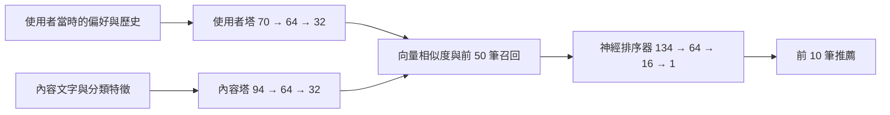
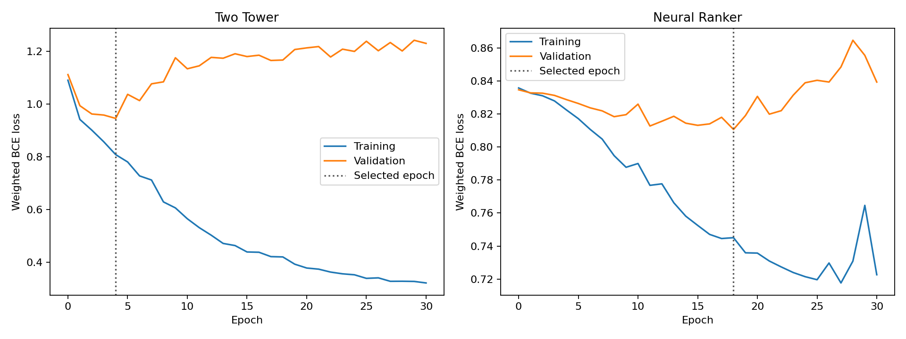

# PyTorch 雙塔召回與神經排序器

本次實作沿用加密貨幣內容推薦情境，新增使用者塔、內容塔與神經排序器，完成時間排序的訓練與驗證、候選召回、推薦評估、checkpoint 儲存與重新載入，並將訓練結果加入 Streamlit 的 PyTorch Models 頁籤。

[公開展示](https://rkatmcugsybuh4d5cejg6s.streamlit.app/)，可查看訓練曲線、八種模型的評估表，以及各使用者的已儲存推薦結果。

## 1. 本次完成的內容

| 元件 | 完成內容 |
|---|---|
| V7 雙塔召回 | 使用 PyTorch 訓練使用者塔與內容塔，將兩側特徵轉為 32 維向量，依向量相似度取前 50 筆候選 |
| V8 神經排序器 | 凍結雙塔權重，將候選的向量、交互特徵與內容特徵送入多層感知器，再取前 10 筆結果 |
| 訓練與選模 | 每個模型訓練 30 個 epoch，依各自驗證區段的最低損失保存權重 |
| 評估 | 沿用共用截止點與 30 位合成使用者的測試目標，產生八種模型的指標與逐人明細 |
| checkpoint | 保存模型權重、設定、特徵重建所需的合成資料與使用者歷史狀態，載入時使用 `weights_only=True` |
| 產出檢查 | 重新載入 checkpoint，核對候選 ID、推薦 ID、分數與檔案 SHA-256 |
| 展示 | PyTorch Models 頁籤讀取本次訓練的曲線、指標與推薦清單，提供 checkpoint 與本文件入口 |

## 2. 資料與標籤

資料包含 240 筆合成內容、80 位合成使用者與 8,564 筆互動事件，外層訓練截止時間為 2026-03-08 04:48 UTC，訓練使用 6,852 筆事件，推薦內容清單保留截止點前已發布的 199 筆內容。

每筆訓練範例以曝光時間作為請求時間，使用者特徵只讀取該時間之前的事件，同一時間點的事件會在該時間點的請求特徵建立後更新到歷史。

標籤採用曝光後 15 分鐘內的互動，點擊、喜歡或收藏標為 1，隱藏標為 0，只有曝光而未產生正向行為的內容標為 0，同一配對出現隱藏時保留負向結果。

曝光的觀察時間需要在所屬區段結束前完成，因此跨越區段邊界的觀察窗會被排除，內容發布時間與已讀歷史也會限制當次可用的候選內容。

## 3. 四個訓練與驗證區段

外層訓練事件依不同時間點排序，以第 50%、65%、85% 與最後一個時間點劃分四個區段，兩個模型的訓練與驗證使用下列資料。

| 區段 | 結束時間 UTC | 完整曝光範例 | 模型採用的範例 |
|---|---|---:|---:|
| 雙塔訓練 | 2026-02-03 19:47 | 2,345 | 2,345 |
| 雙塔驗證 | 2026-02-13 05:58 | 689 | 689 |
| 排序器訓練 | 2026-02-27 04:55 | 911 | 533 |
| 排序器驗證 | 2026-03-08 04:48 | 681 | 394 |

雙塔在前兩個區段完成訓練與選模，權重凍結後用於後兩個區段的候選召回，排序器採用其中進入前 50 筆候選的曝光範例，再用自己的驗證區段選擇權重。

外層測試資料位於訓練截止點之後，測試目標的選取與指標計算沿用專案的共同評估入口。

## 4. 雙塔如何產生候選

使用者塔接收 70 維特徵，內容包括填寫的主題、幣種與難度偏好，歷史正向內容與隱藏內容的分類摘要，以及互動數量，內容塔接收 94 維特徵，包含標題與摘要的文字雜湊、主題、幣種、難度、內容類型與品質分數。

文字採用固定 64 維的雜湊轉換，分類欄位使用專案定義的類別，兩者逐筆轉換內容，特徵建立流程不需要對整份內容清單擬合詞彙表。

兩座塔各包含一層 64 維隱藏層與 ReLU，輸出經 L2 正規化的 32 維向量，訓練以向量內積除以 0.2 再加上偏置形成 logit，使用類別加權的二元交叉熵學習曝光結果。

推薦時依向量內積排序，排除看過的內容後保留前 50 筆，同分內容沿用專案的分數精度與內容 ID 排序規則。



## 5. 神經排序器如何排序

排序器使用 134 維輸入，包含使用者向量、內容向量、兩者的逐元素乘積與絕對差，以及主題匹配、幣種匹配、難度匹配、品質、新鮮度與使用者互動量六項特徵。

排序網路依序包含 64 維與 16 維隱藏層，使用 ReLU 與類別加權的二元交叉熵訓練，輸出經 sigmoid 轉成排序分數，模型只對雙塔召回的候選評分。

兩個階段都使用 AdamW，學習率為 0.003、weight decay 為 0.001、batch size 為 128、亂數種子為 42，執行裝置為 CPU。

## 6. 本次訓練曲線與選用權重



每張圖包含訓練損失與驗證損失，虛線標示被保存的 epoch，雙塔採用第 4 個 epoch，神經排序器採用第 18 個 epoch，兩者的權重都與初始化權重不同。

| 階段 | 選用 epoch | 該 epoch 的驗證損失 |
|---|---:|---:|
| 雙塔 | 4 | 0.945872 |
| 神經排序器 | 18 | 0.810582 |

每個 epoch 的數值保存在 [training_history.csv](artifacts/neural/training_history.csv)，訓練設定、區段邊界、正負標籤數與環境版本保存在 [run_summary.json](artifacts/neural/run_summary.json)。

## 7. 本次推薦指標

下表使用相同的凍結內容清單與 30 位合成測試使用者，每位使用者有一筆測試目標，推薦清單長度為 10，因此 Hit Rate 與 Recall 的數值相同。

| 模型                       |   Hit / Recall@10 |   NDCG@10 |   候選召回率 |   內容覆蓋率 |
|:---------------------------|------------------:|----------:|-------------:|-------------:|
| v1_popularity              |            0.1333 |    0.0525 |       1      |       0.1005 |
| v2_content_based           |            0.1333 |    0.0711 |       1      |       0.6884 |
| v3_collaborative_filtering |            0.0333 |    0.0105 |       1      |       0.7638 |
| v4_hybrid                  |            0.1333 |    0.0617 |       1      |       0.6281 |
| v5_logistic_ranker         |            0.6667 |    0.3981 |       1      |       0.4322 |
| v6_diversity_reranking     |            0.6667 |    0.3991 |       1      |       0.4372 |
| v7_pytorch_two_tower       |            0.1333 |    0.0452 |       0.7333 |       0.4673 |
| v8_pytorch_neural_ranker   |            0.2333 |    0.1013 |       0.7333 |       0.4724 |

雙塔與神經排序器的候選集合相同，本次候選召回涵蓋 22 位測試使用者的目標，雙塔前 10 筆結果命中 4 位使用者，神經排序器前 10 筆結果命中 7 位使用者。

[完整實驗報告](reports/NEURAL_EXPERIMENT_RESULTS.md)，包含訓練範例數、選用權重與八種模型的評估結果，逐人結果保存在 [evaluation_details.csv](artifacts/neural/evaluation_details.csv)。

## 8. checkpoint 與重載驗證

[neural_recommender.pt](artifacts/neural/neural_recommender.pt) 保存雙塔與排序器的 `state_dict`、模型設定、特徵重建資料與歷史狀態，載入時指定 CPU 與 `weights_only=True`，再將模型切換為評估模式。

本次對 80 位既有使用者與 1 位新使用者重載驗證，候選 ID 與分數通過核對，召回分數的最大絕對差為 0，匯出的 80 位使用者推薦 ID 與分數也通過核對。

```python
from pathlib import Path
from src.neural import NeuralSystem

system = NeuralSystem.load(Path("artifacts/neural/neural_recommender.pt"))
models = system.recommenders()
result = models["v8_pytorch_neural_ranker"].recommend("U0001", k=10)
print(result[["content_id", "title", "score"]])
```

## 9. 安裝、訓練與檢查

本次訓練使用 macOS ARM64、Python 3.9.6 與 PyTorch 2.6.0，神經模型依賴獨立放在 `requirements-neural.txt`，安裝後可執行以下流程。

```bash
python3 -m venv .venv
source .venv/bin/activate
python -m pip install -r requirements-neural.txt
python -m pip check
python -m pytest -q
python -m src.run_neural
python -m src.run_neural --verify-only
streamlit run app.py
```

`run_neural` 產生訓練曲線、checkpoint、推薦清單、時間稽核紀錄與模型指標，`--verify-only` 讀取匯出檔案，核對 SHA-256 與 checkpoint 重載後的推薦結果。

本次執行通過 38 項測試，神經模型測試涵蓋權重訓練、驗證選模、觀察窗邊界、當次標籤不影響請求特徵、內容特徵獨立轉換、候選範圍、checkpoint 重載與固定種子 CPU 重跑。

## 10. 既有流程的檢查與修正

本次檢查補上共同評估入口的有效性檢查，重複使用者、內容清單外的測試目標與訓練期間已看過的目標會產生明確錯誤，互動聚合也會拒絕未知事件類型，這些情況都有對應測試。

六種基線沿用原有資料、時間切分與模型設定，神經模型在同一份外層訓練資料內建立自己的曝光範例與時間區段，並透過共同評估入口輸出指標。

## 11. 程式與產出索引

| 路徑 | 內容 |
|---|---|
| `src/neural.py` | 請求時間特徵、雙塔、神經排序器、訓練、候選召回與 checkpoint |
| `src/run_neural.py` | 執行訓練、八模型評估、產出匯出與重載檢查 |
| `tests/test_neural.py` | 時間邊界、訓練、候選與重現性測試 |
| `artifacts/neural/training_examples.csv` | 曝光時間、標籤觀察窗、所屬區段與排序器候選標記 |
| `artifacts/neural/training_curves.png` | 兩階段的訓練與驗證損失 |
| `artifacts/neural/model_metrics.csv` | 八種模型的共同評估結果 |
| `artifacts/neural/recommendations.csv` | 80 位使用者的兩種神經推薦清單 |
| `artifacts/neural/manifest.json` | 八個產出檔案的 SHA-256 |
| `artifacts/neural/neural_recommender.pt` | 本次選用權重與重建資料 |

模型儲存與載入的 API 依 [PyTorch 官方教學](https://docs.pytorch.org/tutorials/beginner/saving_loading_models.html)，模型初始化、固定種子與確定性運算設定依 [PyTorch 重現性說明](https://docs.pytorch.org/docs/2.6/notes/randomness.html)。
