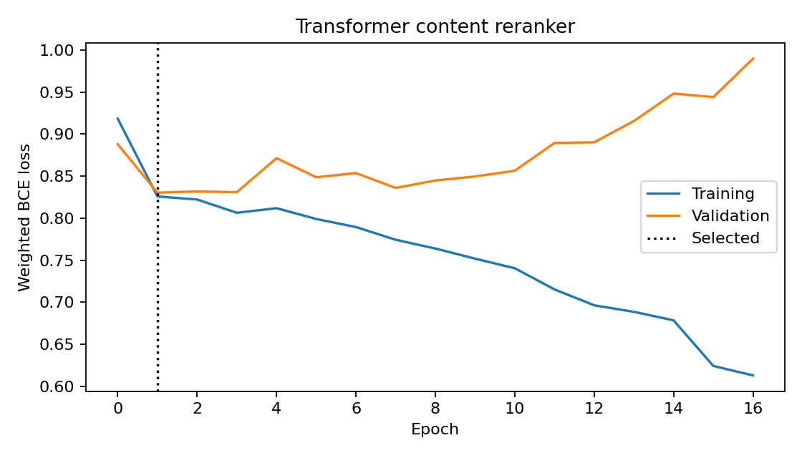

# Transformer 內容重排序：品質、延遲與資源成本量測

本版本在加密貨幣內容推薦流程中新增 V9 Transformer 重排序器，沿用 V7 雙塔召回的候選集合，完成訓練、checkpoint 重載、離線品質評估，以及與 V8 神經排序器的 CPU 效能量測。

## 模型與推薦流程

模型從本專案的合成資料訓練，將使用者偏好與歷史特徵投影為一個向量詞元，再與內容標題、摘要的詞元共同送入 Transformer，透過分類詞元的輸出計算排序分數。

| 設定 | 本版本內容 |
|---|---|
| 內容輸入 | 標題與摘要，最多 32 個詞元 |
| 詞元編碼 | SHA-256 雜湊至 2,047 個有效 ID，另以 ID 0 表示 padding |
| 序列結構 | 分類詞元、使用者向量詞元、內容詞元，共 34 個位置 |
| Transformer | 2 層、每層 4 個注意力頭，向量寬度 32、前饋寬度 64 |
| 位置與遮罩 | 學習式位置向量，padding 位置由注意力遮罩排除 |
| 訓練目標 | 以曝光後的正負回饋計算加權二元交叉熵 |
| 召回與排序 | 固定 V7 雙塔，每位使用者最多召回 50 筆，再由 V9 排序 |

每層 Transformer 分別建立初始參數，模型使用 PyTorch 2.6 的 [TransformerEncoderLayer](https://docs.pytorch.org/docs/2.6/generated/torch.nn.TransformerEncoderLayer.html) 實作，自注意力同時處理使用者向量與內容詞元。

## 訓練與時間切分

訓練資料沿用既有雙塔與 V8 的時間區段，使用請求前的使用者歷史建立特徵，曝光標籤取自 15 分鐘內的回饋，標籤觀察範圍限制於所屬時間區段。

V9 使用與 V8 相同的候選曝光樣本，訓練區段有 533 筆、驗證區段有 394 筆，模型共執行 16 個 epoch，依最低驗證損失選取 epoch 1，並保存每一筆樣本的區段、曝光時間與標籤結束時間。

本次 Transformer 的樣本建立及訓練耗時為 6.618 秒，程序 CPU 時間為 6.500 秒，計時範圍包含 Transformer 樣本建立與訓練，既有雙塔的訓練結果由 checkpoint 載入。



## 推薦品質

評估使用共同截止點後的 30 位合成使用者測試目標，三種模型共用相同內容範圍與候選召回規則，每位使用者評估前 10 筆推薦。

| 模型 | Hit Rate@10 | NDCG@10 | 候選召回率 | 內容覆蓋率 |
|---|---:|---:|---:|---:|
| V7 雙塔召回 | 0.1333 | 0.0452 | 0.7333 | 0.4673 |
| V8 神經排序器 | 0.2333 | 0.1013 | 0.7333 | 0.4724 |
| V9 Transformer 重排序 | 0.2000 | 0.1225 | 0.7333 | 0.2613 |

本次樣本中的 V9 NDCG@10 比 V8 增加 0.0212，Hit Rate@10 減少 0.0333，內容覆蓋率也下降，完整指標與逐位使用者結果均已保存。

以相同使用者的 NDCG 差值執行 2,000 次 bootstrap，平均差值為 0.0212，95% 百分位區間為 −0.0893 至 0.1458，區間涵蓋 0，結果對應本次 30 位合成使用者樣本。

## CPU 延遲與吞吐量

量測使用 macOS arm64、15 個邏輯 CPU 與 24 GiB 實體記憶體，PyTorch 為 2.6.0，運算採用 CPU FP32，每個工作程序設定一個 PyTorch 運算執行緒，請求併發數為 1。

四個回合以 V8、V9 及 V9、V8 的順序輪替，每個模型在兩個回合先執行、兩個回合後執行，每次啟動獨立工作程序，先暖機 10 次，再對相同使用者順序執行 100 次請求，兩個模型各完成 400 次量測，錯誤數均為 0。

| 模型 | p50 毫秒 | p95 毫秒 | p99 毫秒 | 每秒請求數 |
|---|---:|---:|---:|---:|
| V8 神經排序器 | 0.3621 | 0.4186 | 0.5168 | 2,427.19 |
| V9 Transformer 重排序 | 3.2149 | 3.9040 | 4.2912 | 296.75 |

單次延遲從推薦函式呼叫開始計時，涵蓋雙塔召回、候選排序與前 10 筆結果格式化，內容詞元在模型載入時建立快取，這組數值描述程序內暖機後的推薦函式，吞吐量採用全部請求數除以量測區間總時間。

## 資源成本

程序 CPU 時間以每 1,000 次請求換算，記憶體由獨立工作程序每 1 毫秒取樣 RSS，表中記錄暖機後的取樣峰值，包含 Python、PyTorch、模型與資料物件。

| 模型 | 每 1,000 次請求 CPU 秒數 | 取樣峰值 RSS MiB | 推薦路徑參數 KiB | checkpoint 合計 MiB |
|---|---:|---:|---:|---:|
| V8 神經排序器 | 0.3757 | 307.81 | 95.63 | 1.335 |
| V9 Transformer 重排序 | 3.3439 | 311.97 | 394.13 | 1.698 |

V9 的記憶體量測包含載入基礎 NeuralSystem 時保留的 V8 排序器，推薦路徑使用的參數為 403,592 bytes，程序內模型參數合計為 442,380 bytes，兩者分別記錄於效能檔案，checkpoint 合計包含基礎 checkpoint 與 Transformer checkpoint。

CPU 時間包含 RSS 取樣執行緒的用量，本次資源成本以 CPU 秒數、RSS、參數與檔案大小表示，各回合的模型載入時間也保存在工作程序紀錄中。

## 產出與驗證

`reports/transformer_reranking` 保存 12 個產出檔案及 manifest，包含 checkpoint、訓練曲線、樣本時間稽核、品質指標、逐位使用者結果、推薦清單、800 筆延遲紀錄及八個工作程序紀錄。

checkpoint 對應的基礎雙塔檔案以 SHA-256 綁定，重新載入後核對 80 位使用者及一位新使用者的推薦，分數最大誤差為 0，內容與順序一致。

驗證入口會核對全部產出雜湊、訓練曲線與 checkpoint、樣本時間區段、推薦結果及品質指標，並由原始請求紀錄重算 p50、p95、p99、吞吐量與資源摘要，測試涵蓋曲線、指標、效能摘要及請求缺漏的修改情境。

完整本機測試共 198 項通過，其中新增 16 項 Transformer 測試，並執行 CPU 雙程序 DDP 與關閉 CPU fallback 的 MPS 檢查，摘要保存於 [版本驗證紀錄](reports/TRANSFORMER_VALIDATION.json)。

## 執行方式

安裝依賴後，使用空的輸出目錄執行訓練與量測，命令會保存 checkpoint 並執行產出驗證。

```bash
python -m pip install -r requirements-neural.txt
python -m src.run_transformer --output reports/transformer_reranking_new
```

核對本版本保存的結果時，使用以下命令，品質與推薦會從 checkpoint 重新計算，效能統計則由已保存的原始量測資料重算。

```bash
python -m src.run_transformer --verify-only
python -m pytest -q tests/test_transformer_reranker.py
RUN_DDP_INTEGRATION=1 python -m pytest -q
```

新增程式位於 `src/transformer_reranker.py` 與 `src/run_transformer.py`，測試位於 `tests/test_transformer_reranker.py`，GitHub Actions 已納入模型與產出驗證。
