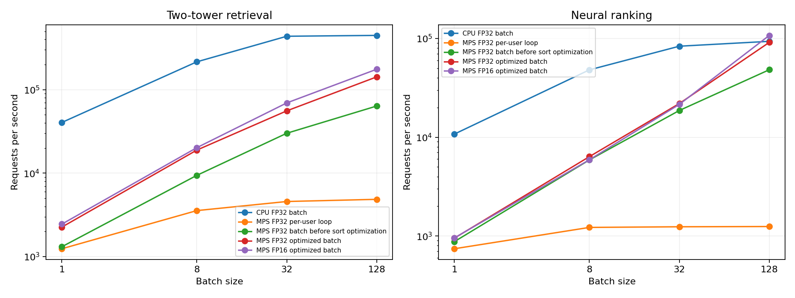

# GPU 批次推論與 Profiling：相容性修正及完整輸出稽核

本次檢查 GPU 批次介面的推薦數量行為，以及 profiling 對使用者與量測路徑的驗證範圍，修正小候選上限的相容性問題，補上結果張量檢查，並讓每個裝置、精度、模式與批次大小都完成輸出核對。

本次六回合輪替、逐回合比較與產出驗證的更新，請見 [GPU 量測方法更新](README_GPU_MEASUREMENT_AUDIT.md)，本文保留前版相容性與逐組驗證紀錄。

## 1. 檢查結果與修正

| 檢查項目 | 發現的問題 | 完成的修正 |
|---|---|---|
| 推薦數量 | 候選上限為 5 時，GPU 介面拒絕預設 `k=10`，既有 CPU 介面會回傳可用的 5 筆 | 共用推薦數量驗證，依候選上限截斷輸出 |
| 使用者覆蓋 | 精度稽核使用 `zip` 配對結果，缺少使用者結果時仍能產生部分通過紀錄 | 要求回傳列數等於請求使用者數 |
| 結果張量 | 解碼流程缺少形狀、索引與非有限分數檢查 | 驗證二維形狀、整數索引、內容範圍與分數有效性 |
| 量測路徑 | 原精度核對採用整批 81 位使用者，逐筆模式與各量測批次缺少逐組檢查 | 在每組計時前，核對該組實際使用的請求與推論路徑 |

## 2. 推薦數量的相容性

GPU 批次入口採用專案共用的 `validate_k`，接受非負整數，再以可用候選數決定輸出上限，候選數不足時保留可用結果，`k=0` 回傳空推薦。

新增測試使用候選上限 1 與 5，對 V7、V8 分別執行 `k=10`、`k=100` 與 NumPy 整數型別請求，再核對 CPU 介面的內容 ID、順序與分數。

| 候選上限 | 請求 `k` | 兩個模型的回傳數量 |
|---|---:|---:|
| 1 | 10、100 | 1 |
| 5 | 10、100 | 5 |

負數、布林值與小數型推薦數會被拒絕，這項修改沿用原有候選排序與模型權重。

## 3. 結果解碼與完整性

`decode` 要求索引與分數具有相同的二維形狀，索引需要是內容清單範圍內的整數，NaN 與正無限分數會產生錯誤，負無限值保留作為已排除內容的填充值。

`audit_result` 接著核對回傳張量的裝置與分數精度，確認每位請求使用者都有一列結果，每列的推薦數量符合 CPU 參考，並拒絕重複內容 ID。

稽核紀錄增加 `common_score_items`，每筆分數誤差都有對應的共同內容數量，再記錄推薦順序、前十筆集合重合率及 CPU 候選範圍核對。

## 4. 每個量測組合的輸出核對

計時前會使用該組已準備的輸入呼叫實際量測路徑，分別核對 CPU 批次、MPS 逐筆迴圈、原批次路徑與優化批次路徑，驗證完成後進入暖機與計時。

| 驗證範圍 | 本次覆蓋 |
|---|---|
| 批次大小 | 1、8、32、128 |
| CPU | FP32 優化批次路徑 |
| MPS | FP32、FP16，各包含逐筆迴圈、原批次與優化批次路徑 |
| 計時組合 | 56 組 |
| 逐組請求核對 | 2,366 筆 |
| 固定 81 位使用者的精度核對 | 486 筆，包含兩種模型及三個裝置／精度組合 |
| 整批延遲紀錄 | 1,680 筆，每組 30 批 |

FP32 的核對要求推薦順序一致，且共同內容的最大分數誤差不超過 `1e-5`，任何一組未通過時量測程式會以失敗狀態結束，驗證與計時各自保存資料。

## 5. 本次逐組核對結果

| 裝置／精度    | 模型          |   核對筆數 |   順序完全一致 | 前十筆集合重合率   |   共同內容最大分數誤差 |
|:--------------|:--------------|-----------:|---------------:|:-------------------|-----------------------:|
| cpu / float32 | V7 雙塔召回   |        169 |            169 | 100.0%             |             1.2e-07    |
| cpu / float32 | V8 神經排序器 |        169 |            169 | 100.0%             |             1.2e-07    |
| mps / float16 | V7 雙塔召回   |        507 |            471 | 100.0%             |             0.00041309 |
| mps / float16 | V8 神經排序器 |        507 |            465 | 100.0%             |             0.00051397 |
| mps / float32 | V7 雙塔召回   |        507 |            507 | 100.0%             |             1.2e-07    |
| mps / float32 | V8 神經排序器 |        507 |            507 | 100.0%             |             1.2e-07    |

本次 FP32 的 1,352 筆逐組紀錄，推薦順序全部一致，最大分數誤差為 0.00000012，每筆都有 10 個共同內容可核對，表中的筆數依各組請求逐筆計算。

FP16 的前十筆內容集合重合率為 100%，V7 有 36 筆逐組紀錄的順序不同，V8 有 42 筆逐組紀錄的順序不同，精度紀錄保留這些差異，批次介面的預設精度維持 FP32。

固定 81 位使用者的另一組精度核對，MPS FP32 的兩個模型均有 81 位順序一致，MPS FP16 的兩個模型各有 76 位順序一致，結果保存於 `precision_validation.csv`。

## 6. 本次重新量測的效能

本次沿用 Apple M5 Pro、24.0 GiB 統一記憶體、Python 3.9.6 與 PyTorch 2.6.0，關閉 MPS CPU fallback，使用相同 checkpoint 與 199 筆內容，每組暖機 2 批，再執行 3 回合、每回合 10 批。

批次大小 128 的優化路徑，效能結果如下。

| 裝置／精度    | 模型          |   整批 p50 ms |   每秒請求量 |
|:--------------|:--------------|--------------:|-------------:|
| cpu / float32 | V7 雙塔召回   |         0.246 |     446641   |
| cpu / float32 | V8 神經排序器 |         1.339 |      93450.3 |
| mps / float32 | V7 雙塔召回   |         0.836 |     142369   |
| mps / float32 | V8 神經排序器 |         1.393 |      91232.4 |
| mps / float16 | V7 雙塔召回   |         0.714 |     175727   |
| mps / float16 | V8 神經排序器 |         1.185 |     107333   |



整批計時從已準備的裝置輸入開始，到裝置上的推薦輸出完成為止，GPU 在每筆計時前後同步，輸入準備、階段探測與 CPU 派發 trace 分別保存。

## 7. 測試與重現方式

本次新增 18 個回歸案例，完整測試在實體 MPS 環境通過 126 項，測試涵蓋小候選上限、超過候選數的請求、異常結果張量、缺少使用者或內容、重複內容、錯誤裝置與精度，以及三種計時模式的完整核對。

```bash
python -m pip install -r requirements/requirements-gpu.txt
PYTORCH_ENABLE_MPS_FALLBACK=0 python -m pytest -q
python -m src.run_neural --verify-only
PYTORCH_ENABLE_MPS_FALLBACK=0 python -m src.profile_gpu \
  --batch-sizes 1 8 32 128 --iterations 10 --repetitions 3 \
  --output reports/gpu_profile_review
python -m src.plot_gpu_profile --input reports/gpu_profile_review
```

繪圖入口新增 `--input`，可指定要讀取的量測目錄，本次結果保存在 `reports/gpu_profile_review/`，原 GPU profiling 版本的產出保留於 `reports/gpu_profile/`。

## 8. 程式與證據索引

| 檔案 | 內容 |
|---|---|
| [src/gpu_inference.py](../src/gpu_inference.py) | 推薦數量截斷與結果張量驗證 |
| [src/profile_gpu.py](../src/profile_gpu.py) | 完整結果稽核與每組量測前的輸出核對 |
| [tests/test_gpu_inference.py](../tests/test_gpu_inference.py) | 本次相容性與稽核回歸案例 |
| [逐組輸出核對](../reports/gpu_profile_review/variant_validation.csv) | 56 組量測路徑的 2,366 筆驗證紀錄 |
| [固定使用者精度核對](../reports/gpu_profile_review/precision_validation.csv) | 486 筆使用者、模型與精度核對 |
| [效能摘要](../reports/gpu_profile_review/summary.csv) | 各裝置、精度、模式與批次大小的效能 |
| [逐批計時](../reports/gpu_profile_review/timings.csv) | 1,680 筆整批延遲 |
| [完整結果](../reports/gpu_profile_review/results.json) | 執行環境、來源雜湊與驗證覆蓋數量 |
| [記憶體樣本](../reports/gpu_profile_review/memory_samples.csv) | MPS 張量與 Metal 驅動配置取樣 |
| [階段計時](../reports/gpu_profile_review/stages.csv) | 原路徑與優化路徑的同步階段耗時 |
| [CPU 派發 trace](../reports/gpu_profile_review/cpu_dispatch_trace.json) | 主機算子與 profiling 階段記錄 |
| [檔案雜湊](../reports/gpu_profile_review/manifest.json) | 本次產出檔案的 SHA-256 |
| [GPU profiling 初版說明](README_GPU_PROFILING.md) | 批次架構、排序優化與原始量測 |
